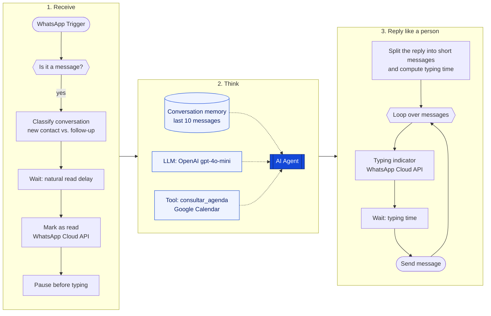
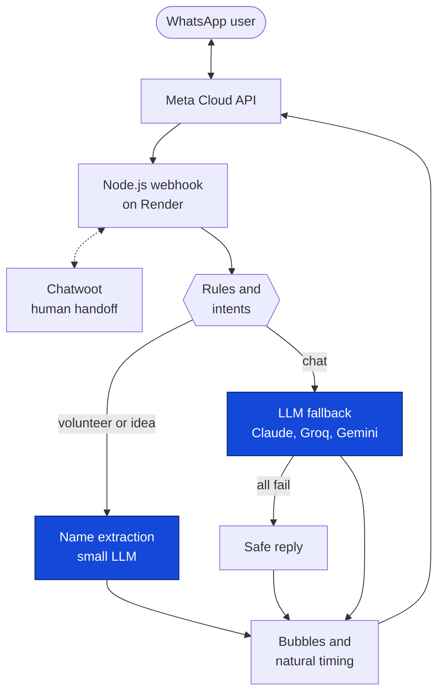
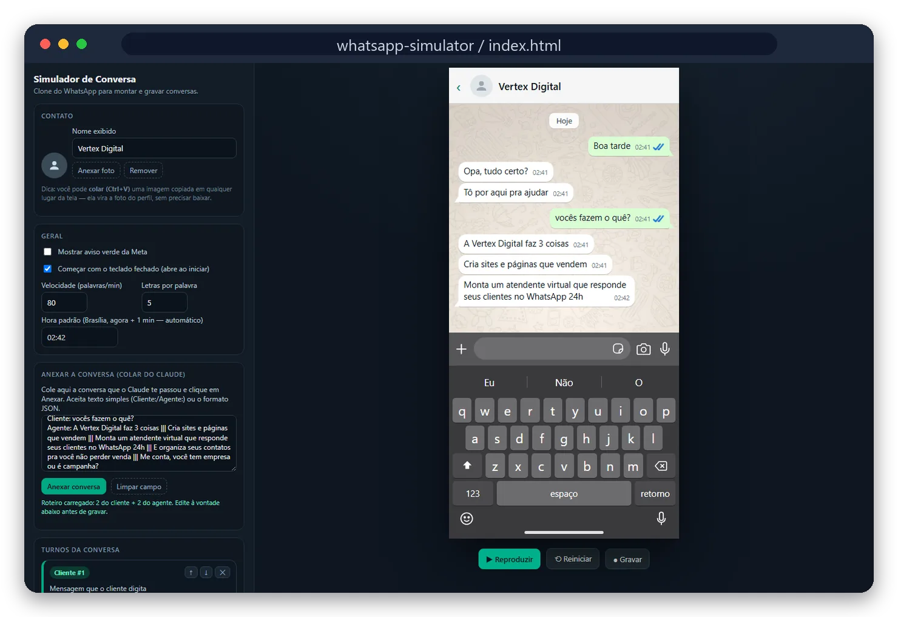
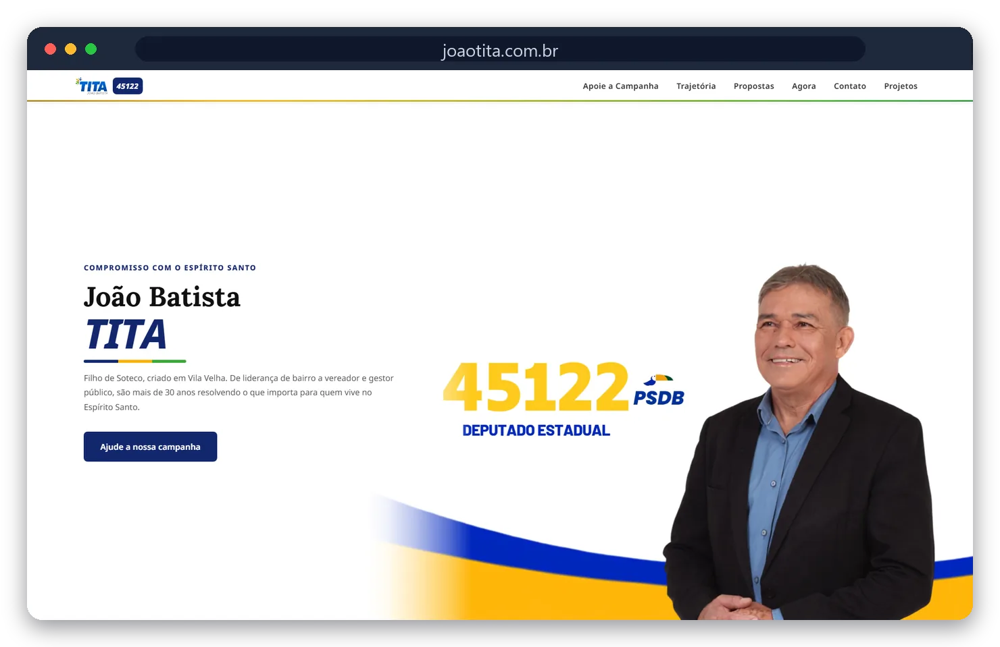
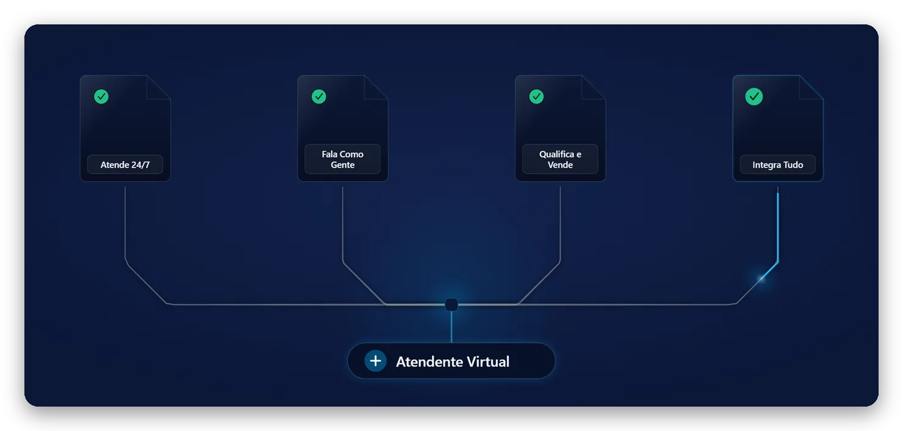

  

  
  
  
  

# Hi, I'm Guilherme Bernardes 👋

I am a Brazilian Portuguese professional focused on AI evaluation, LLM quality assurance, prompt testing, data quality and workflow automation.

My background combines Business Administration, data analysis, CRM operations and practical experience designing and testing AI-powered workflows for Portuguese-language use cases.

## What I work with

<table>
<tr>
<td valign="top" width="50%">

**AI evaluation and quality**

- Portuguese-language AI response evaluation
- Prompt and response testing
- Accuracy, clarity, tone and instruction-following review
- Fact-checking and unsupported-claim detection
- AI agent evaluation and quality documentation

</td>
<td valign="top" width="50%">

**Automation and data**

- Conversation design and request classification
- n8n workflow automation
- LLM, API, WhatsApp, calendar and CRM integrations
- Excel, dashboards, Power BI and operational data analysis

</td>
</tr>
</table>

## Featured project

### Vertex Digital — AI Automation Workflow

Designed and tested an AI-assisted workflow integrating an LLM, n8n, WhatsApp, conversation memory, request classification, calendar tools, CRM, APIs and human handoff.

The project included:

- Prompt and persona design
- Guardrails and fallback rules
- Portuguese-language response evaluation
- Detection of unsupported claims and inconsistent outputs
- Conversation-flow testing
- Workflow documentation and quality review

> [!NOTE]
> Vertex Digital is my own independent project. It is not related to Google Cloud Vertex AI.

**How the n8n workflow runs (15 nodes)**

**What testing changed: prompt evaluation log**

The first real use case was a Portuguese-language WhatsApp assistant for a 2026 state-legislature campaign in Espírito Santo, Brazil. Each version of the prompt came from reviewing test conversations:

| Version | What the test conversations showed | What changed in the prompt |
|:-:|---|---|
| v1 | Initial build | Four conversation paths (proposals, volunteering, community requests, talking to the candidate), deflection of sensitive topics and silent escalation to a human |
| v2 | The assistant asked for personal data by default, and greetings felt like an interrogation | Collect data only when there is a clear reason; light, varied greetings; shorter volunteer sign-up; updated few-shot examples |
| v3 | Answers added background nobody had asked for | Answer only what was asked; new calendar tool, with a rule to never invent dates, times or events |
| v4 | Scenarios the prompt did not cover | Full scenario map: community requests, agenda availability, donation questions with their legal limits, polarizing topics and suspicious interactions flagged to a human |
| v5 | Too many emojis and long single messages | At most one emoji per exchange; separate ideas sent as separate messages |
| v6 | Em dashes in replies and no rule for offensive messages | No em dashes; calm with mild offenses, a firm boundary with explicit insults |
| v7 | Duplicated rules and token cost | Removed duplicated instructions, prompt caching, compact data format for tool results, memory window review. No change in behavior |

## Portfolio

### 🤖 Multi-provider WhatsApp agent (Node.js)

The same assistant rebuilt as a Node.js server, with the natural-timing logic ported from the n8n flow.

- Automatic fallback across three LLM providers (Claude Haiku, Groq Llama 3.1, Gemini Flash), each with a 12-second timeout so no provider can stall a reply
- When every provider fails, a safe reply says the assistant would rather confirm than give a wrong answer
- A rule layer runs before the LLM: fixed replies, keyword triggers and intent detection; for volunteer sign-ups and idea suggestions, a small LLM extracts only the name (and the idea) from free text
- Tool calling (register a volunteer, register an idea, flag a conversation for a human) with one schema adapted to each provider's format
- Human handoff through Chatwoot: the bot goes silent when a person replies in the same thread
- Read receipts and typing indicators timed like a person typing

`Node.js` `Express` `Anthropic Claude` `Groq` `Google Gemini` `WhatsApp Cloud API` `Chatwoot` `Render`

### 🧩 Persona and prompt toolkit

- **WhatsApp persona builder** (a Claude Code skill I built): a branching intake form that produces a system prompt for n8n's AI Agent node plus a readable persona spec. It draws on reference libraries for conversation scenarios, guardrails, tones of voice, tools and token economy, has a test mode that simulates the WhatsApp conversation before deployment, and an edit mode that keeps a versioned changelog.
- **Demo persona template:** only verifiable public facts go into the prompt, and when in doubt the assistant deflects instead of guessing. It stays neutral on polarizing topics and never makes promises.
- **Review process:** a human checks every persona before use (name, role, city, people with the same name), and the demo questions and answers are approved before any video is recorded.

### 💬 WhatsApp conversation simulator

A standalone HTML, CSS and JavaScript replica of the iOS WhatsApp interface that I use to script, play back and record demo conversations. It imports transcripts as plain text or JSON, splits replies into separate bubbles and simulates typing speed, read receipts and the keyboard.

`HTML` `CSS` `JavaScript`

### 📊 Campaign finance and accountability panel (prototype)

A multi-tenant panel for recording campaign income and expenses.

- Receipt and invoice reading in layers: free deterministic steps first (QR code, PDF text, access-key parsing, company lookup through BrasilAPI), then Google Gemini Flash as a fallback for photos and scans. The model must return strict JSON and is told to return null rather than invent a value.
- Access control with Supabase Auth and 22 PostgreSQL row-level security policies
- Dashboards for cash flow, daily movement and goals
- Spreadsheet export organized by the fields of SPCE, the Brazilian electoral accountability system

`Next.js` `TypeScript` `Supabase` `PostgreSQL` `Google Gemini` `Tailwind CSS`

### 🌐 Vertex Digital website · [vertexdigital.dev.br](https://vertexdigital.dev.br)

- Scroll-driven animation (GSAP, Framer Motion, Lenis) and a service-area map (MapLibre)
- Contact form API that stores leads in Supabase and sends an email notification
- Technical SEO: JSON-LD structured data, sitemap, Open Graph images for every page and an `llms.txt` file for AI crawlers
- Daily keep-alive job and continuous deployment on Vercel

`Next.js` `React` `TypeScript` `Tailwind CSS` `Supabase` `Vercel`

### 🗳️ Campaign websites · [joaotita.com.br](https://www.joaotita.com.br)

- Client website for a 2026 state-deputy campaign, exported as a static site to meet the electoral rule of hosting in Brazil, with the official donation widget
- Reusable campaign-site template with colors set per candidate through CSS theme tokens
- Demo sites built from a research report on each candidate's public information and deployed on Vercel

`Next.js` `React` `TypeScript` `Tailwind CSS` `Vercel`

### 🎬 Motion graphics as code

Looping service videos for the Vertex Digital website, written in React with Remotion. I also built a Claude Code skill that runs a structured briefing (format, colors, scenes, timing, messages) and outputs a Remotion project ready to render.

`Remotion` `React` `TypeScript`

## Professional background

Before focusing on AI automation, I worked with commercial data, CRM, performance indicators, administrative processes and customer support. This background helps me evaluate AI systems from both a technical and business perspective.

<table>
<tr>
<td align="center" width="25%"><h3>R$ 400k/year</h3>projected savings Supergasbras</td>
<td align="center" width="25%"><h3>680 → ~1,500</h3>new clients per year SGI project, Supergasbras</td>
<td align="center" width="25%"><h3>16 → 24</h3>vehicles sold per month Giuliano O Vendedor</td>
<td align="center" width="25%"><h3>8</h3>sellers supported with reports and analysis</td>
</tr>
</table>

**Founder / AI Automation Project Lead** · Vertex Digital · *June 2026 to present* 
Portuguese-language AI assistants for WhatsApp, prompt and persona design, response evaluation, n8n workflows, websites and CRM integrations.

**Commercial Assistant** · Supergasbras, multinational LPG company · *2024 to 2026*
- Tracked commercial KPIs: contribution margin, EBIT, sales volume, retention and prospecting
- Analyzed a bulk-gas portfolio of about 1,900 clients
- SGI project: new clients per year went from 680 to about 1,500
- Savings project projected at R$ 400k per year by improving the customer-transfer registration process
- Automated reports in VBA for real-time tracking
- Lean methods (A3, Ishikawa, root-cause analysis), customer-experience initiatives and analytical support for a team of 8 sellers

**Commercial Assistant** · Giuliano O Vendedor, automotive retail · *2023 to 2024*
- Integrations with Webmotors, Mobiauto, iCarros and OLX, plus API and automation work between CRMs and listing platforms
- Lead management and distribution, income statements (DRE) and financial performance analysis
- After-sales, vehicle transfer documentation and invoicing
- Monthly sales grew from 16 to 24 vehicles and the store became the 3rd largest in Greater Vitória

**Receptionist** · Pink Elephant · *2023* 
Customer service, entry control, ticket sales and cashier support.

## Tools and technologies

Used in my work and in the projects above.

**AI and automation**
 

**Web and data**
 

**Business and analytics**
 

## Current interests

- AI training and evaluation
- LLM quality assurance
- Portuguese localization
- Data quality and annotation
- Prompt and response writing
- Agent evaluation
- Fact-checking
- Workflow automation

## Education and certifications

🎓 **Bachelor of Business Administration** · Rede de Ensino Doctum · *completed in 2025*

| Certificate | Institution |
|---|---|
| Excel: Dashboards | Kultivi |
| Time Management and Productivity | Kultivi |
| Team Building as a Strategy for Success | Sebrae |
| The Impact of IT on Business | Fundação Getulio Vargas |
| Power BI | Microsoft Power Platform |
| Customer Experience | Specialization |

## Languages

- Portuguese — Native
- English — B2

## Connect with me

[LinkedIn: Guilherme Bernardes](https://www.linkedin.com/in/guilherme-bernardes-192404263/)
